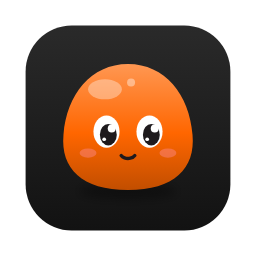

<p align="center"></p>

# Cru Media Player

A new media player.

Cross-platform (macOS, Windows, Linux) video player built with Flutter on top of
libmpv (via [media_kit](https://pub.dev/packages/media_kit)).

## Run

```bash
flutter pub get
flutter run -d macos     # or: -d windows / -d linux
```

- macOS builds need full Xcode (not just Command Line Tools) and CocoaPods
  (`pod` on PATH; set `LANG=en_US.UTF-8`).
- You can pass files or URLs on the command line:
  `"Cru Media Player.app/Contents/MacOS/Cru Media Player" movie.mkv`.

## Engine notes

- media_kit's bundled libmpv/ffmpeg has **no ffmpeg video filters** (`vf`).
  Flips are therefore a Flutter transform over the video, and picture
  controls use mpv's GPU options. Audio filters (`af`, used by the EQ) work.
- Subtitle styles and EQ settings persist via `shared_preferences`; the
  library (history, playlists, pins, folders, channel lists) is
  `library.json` in the app-support folder, with thumbnails in `thumbs/`.
- The bundled ffmpeg has no PNG decoder, so cover art is extracted by the
  app (`lib/library/cover_art.dart`) rather than by mpv.
- Its only audio filter is `equalizer` (no `volume`, `dynaudnorm`, …): the
  EQ's anti-clipping pre-gain is a very wide equalizer band.
- App icons are generated from the blob mascot painter
  (`lib/ui/blob_logo.dart`): `flutter test tool/icons/generate_icons_test.dart`.
- Subtitles are rendered by mpv/libass (`libass: true`) so the Subtitles
  tab's styling is what you see; media_kit's Flutter subtitle overlay is off.

## Tests

```bash
flutter test                      # unit tests
tool/run_integration_test.sh      # end-to-end: real playback, keys, menus
```

The end-to-end test plays `integration_test/fixtures/test-clip.mp4` (made by
`tool/make_test_clip.swift`) and checks pause/OSD, seeking, bookmarks, speed,
volume/mute, subtitle and audio flyouts, menus, Hide UI, the queue and
replay-at-end.
- Windows builds need Visual Studio 2022 with "Desktop development with C++".
- Linux builds need: `sudo apt install clang cmake ninja-build pkg-config libgtk-3-dev libmpv-dev mpv`.

Windows and Linux binaries must be built on those systems (or in CI).

## Keyboard shortcuts

| Key | Action |
|---|---|
| Space / K | Play / pause |
| ← / → | Seek ±5 s (Shift: ±60 s) |
| , / . | Previous / next frame |
| ↑ / ↓ | Volume ±5 |
| M | Mute |
| F / Esc | Fullscreen / exit |
| I | Picture-in-picture |
| N / P | Next / previous in queue |
| [ / ] / Backspace | Slower / faster / reset speed |
| H | Hide UI |
| R | Rotate 90° |
| Z / X | Zoom in / out |
| Ctrl/⌘ + B | Add bookmark |
| Ctrl/⌘ + O | Open file (Shift: folder) |
| Ctrl/⌘ + U | Open network stream |
| Ctrl/⌘ + V | Play link/path from clipboard |
| Ctrl/⌘ + L | Queue & bookmarks panel |
| Ctrl/⌘ + I | Inspector (subtitles, audio, video, playback) |
| Ctrl/⌘ + Shift + L | Library |
| Ctrl/⌘ + W | Close media (back to Home) |
| Ctrl/⌘ + , | Settings |
| S | Screenshot |
| Ctrl/⌘ + G | Multi-view (Esc floats the feeds) |
| Ctrl/⌘ + T | Open & tools |
| Enter / Esc | Accept / dismiss the resume prompt |

## Mouse & trackpad

- Seek bar: drag to scrub, hold **Shift** for 10× finer scrubbing, scroll to step frames.
- Video: scroll for volume; trackpad two-finger swipe on the left half for brightness,
  right half for volume; pinch to zoom; double-click left/right third to jump 10 s,
  centre to toggle fullscreen; right-click for the video menu.
- Drop files onto the window to play, or onto a playing video to add them to the queue.

## Roadmap

1. ✅ Core player: theme, control bar, cone volume, seek bar, auto-hide, subtitle/audio
   flyouts (with output-device switching), OSD, shortcuts, queue, bookmarks, PiP, gestures.
2. ✅ Inspector sidebar:
   - Subtitles: delay, live style preview, presets (built-in + saved), font,
     relative/exact size, colours, outline, shadow, position, ASS override,
     preferred languages.
   - Audio: delay, EQ presets with curve previews, draggable parametric EQ
     (frequency/gain/Q per band, auto pre-gain against clipping), preferred
     languages.
   - Video: looks previewed on the current frame before applying, live
     brightness/contrast/saturation/gamma, rotate/flip/zoom/aspect, GPU
     upscaling quality, HDR tone mapping.
   - Playback: speed, reverse playback, sleep timer (minutes or end of file),
     overlay toggles, formatted media info.
3. ✅ Library & home:
   - Home hub: continue watching (with frame thumbnails and progress), pins,
     playlists, recently played.
   - Resume prompt near the controls when reopening an unfinished file.
   - Library: Videos, Music, Network streams, Playlists, History; breadcrumbs,
     search, Grid/List/Detail views, sorting incl. unwatched/watched first.
   - IPTV: M3U channel lists with groups and logos, auto-refresh when stale,
     channel zapping with N/P.
   - Queue panel Library tab: drag items into the queue while playing.
   - Music layout with cover art (embedded M4A/MP3/FLAC art or folder images).
4. ✅ Scrubbing & subtitles:
   - Frame previews when hovering/dragging the seek bar (hidden second
     player; keyframe seek with exact-seek fallback; cached).
   - Audio waveform (hidden mpv decodes to low-rate PCM; cached on disk) on
     the seek bar (toggle) and as the music view's scrubber.
   - Subtitle timeline over the waveform: drag blocks to re-sync (sets the
     subtitle delay), click to seek, Ctrl/⌘-scroll to zoom. SRT/VTT/ASS.
   - Subtitle loader: sidecars (incl. Subs/ folders), folder batch matching
     for the queue (names or S01E02/1x02), OpenSubtitles.com search by
     file hash + title and download (bring your own free API key).
5. ✅ Settings & personalisation:
   - Settings with 10 panels (General, Interface, Privacy, Controls,
     Playback, Video, Audio, Subtitle, Library, Network & more), search,
     per-panel reset, and a plain-language info icon on every entry.
   - Themes (Charcoal / True black / Graphite) and accent colours, live.
   - First-run onboarding: look, control size + starter layout, shortcuts.
   - Drag-and-drop control bar customizer with switchable saved profiles.
   - GPU shaders: built-in sharpen / line-art / denoise, your own GLSL
     folder, one-click Anime4K (modes A/B/C) and FSR chains when present.
   - Screenshots (S) to a chosen folder as PNG or JPEG.
   - Multi-view (⌘G): up to 3 extra feeds in a grid or as floating
     mini-windows, locked to the main video (play/pause, speed, seeks),
     with per-feed time offset and a choice of which one you hear.
6. ✅ Open & tools (⌘T): one hub for Open file / folder / network stream /
   capture device / clipboard / convert / cast.
   - Capture: live network sources (RTSP, SRT, RTMP, UDP, HTTP/MJPEG) with
     a low-latency mode. Built-in webcams/capture cards need the engine's
     device demuxers, which the bundled ffmpeg lacks.
   - Convert: MP4 1080p/720p, HEVC, audio-only via macOS `avconvert`
     (built in) or `ffmpeg` if installed; progress and cancel.
   - Cast: DLNA/UPnP renderers (TVs, speakers): network search, add by
     address, local files streamed from a built-in server with seeking;
     a top-bar pill controls the TV. (Chromecast/AirPlay not included.)
